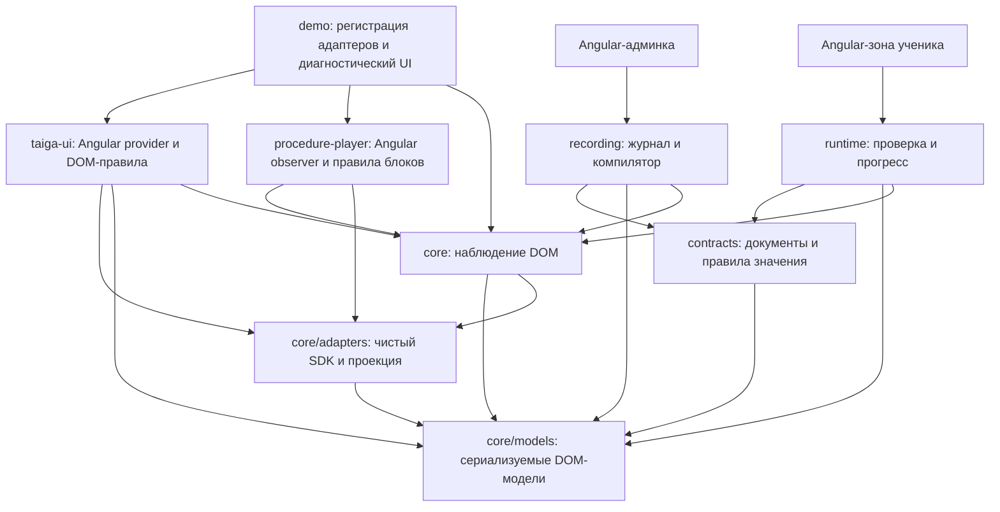
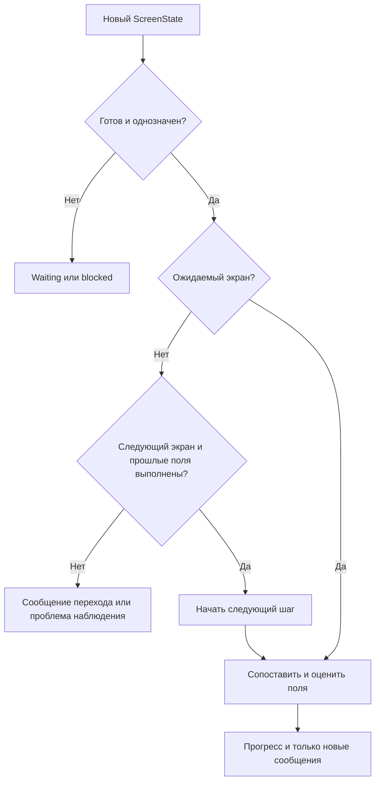

# Архитектура Training Observer

Этот документ описывает текущий код. Незавершённые возможности — в [плане MVP](docs/roadmap.md), прежние решения — в
[архиве](docs/archive/). Алгоритмы не знают названий demo-процедур, их backend или Taiga-форм.

## 1. Границы ответственности

Core — средство наблюдения существующей страницы. Оно сообщает, что видно в DOM, а не правильно ли действует ученик.
Администратор и ученик используют его независимо, в разных сеансах и на разных маршрутах.

Стрелка означает **зависимость кода**. В core нет обратной стрелки на contracts, recording или runtime. `npm run lint`
запускает штатное правило Nx `@nx/enforce-module-boundaries`: разрешённые направления задаются layer-тегами проектов в
`eslint.config.ts`. Отдельного скрипта проверки границ нет. Обычное правило ESLint `no-restricted-imports` уточняет
допустимую точку входа `core/models`, поскольку основной core и его модели принадлежат одному Nx-проекту.
[Документация правила Nx](https://nx.dev/docs/kb/enforce-module-boundaries).

`core/models` и `core/adapters` — entry points того же npm-пакета для DTO и правил проекции снимков. Они отделены по
ответственности; Angular lifecycle и browser sources находятся в основной точке входа core. Contracts содержат
сериализуемые документы и правила чтения учебного значения; core читает наблюдаемое состояние и не применяет эти учебные
правила. Recording и runtime предоставляют Angular-сеансы и собственные алгоритмы; они не импортируют друг друга и не
управляют Taiga UI или storage приложения. `core/adapters` экспортирует `ControlAdapter`, `SnapshotReader`,
`nativeControlKind()` и `projectControls(snapshot, adapters)`; сериализуемые модели остаются в `core/models`. Основные
точки входа `taiga-ui` и `procedure-player` объединяют Angular-провайдеры, наблюдатели и правила проекции, поэтому
требуют Angular и RxJS. Чистые функции внутри этих библиотек сохранены; превращать их в injectable-сервисы не требуется.

`recording` предоставляет `RecordingSession` и `provideRecordingSession()`, `runtime` — `TrainingSession` и
`provideTrainingSession()`. Общий `ObservationConnection` находится в core: он запускает наблюдение после рендера,
подписывается на атомарные
updates$ и освобождает ресурсы по DestroyRef. Feature-сеансы доставляют данные своим движкам.
UI регистрирует адаптер приложения либо задаёт признаки экрана явно, вызывает start/stop, читает readonly signals и
оформляет feedback$.
Селектор области отслеживает поздний mount и замену корня. У фасадов независимые наблюдатели, даже при общем
DI-владельце.

## 2. Как читать исходники

| Вопрос                                        | Начать с                                                                   |
| --------------------------------------------- | -------------------------------------------------------------------------- |
| Что умеет наблюдатель?                        | `libs/training-observer/src/index.ts`, затем `lib/training-observer.ts`    |
| Какие данные он возвращает?                   | `libs/training-observer/models/src/`                                       |
| Как обходится DOM?                            | `lib/capture/dom-snapshot-builder.ts` → `dom-capture.ts`                   |
| Как много DOM-узлов превращаются в одно поле? | `core/adapters` → `adapters/src/control-projection.ts`                     |
| Как распознаётся Taiga UI?                    | `libs/training-taiga-ui/src/`                                              |
| Когда создаётся новый снимок?                 | `lib/observation/dom-observation-session.ts`                               |
| Как работает blur?                            | `lib/observation/blur-confirmation.ts`                                     |
| Как определяется экран?                       | `lib/screen/screen-state-reader.ts`                                        |
| Как записывается пример?                      | `libs/training-recording/src/lib/state-recorder.ts`                        |
| Как журнал превращается в ожидания?           | `libs/training-recording/src/lib/scenario-compiler.ts`                     |
| Как проверяются ответы?                       | `libs/training-runtime/src/lib/scenario-runtime.ts` → `field-evaluator.ts` |
| Почему уведомление не повторяется?            | `libs/training-runtime/src/lib/feedback-tracker.ts`                        |
| Что разрешено сохранять?                      | `libs/training-contracts/src/lib/*.models.ts`, `*-codec.ts`                |

В начале модулей описаны назначение и алгоритм. Публичный API каждой библиотеки расположен в её `src/index.ts`.
Внутренние классы не нужно регистрировать в Angular DI или импортировать в приложение.

## 3. Наблюдение: DOM → ControlSnapshot

`provideDomObservation()` подключает локальные Angular-фасады и фабрику сеансов. `TrainingObserver` — Angular Facade
одного сеанса. `start(root, overrides)` сначала проверяет настройки и строит исходный снимок, затем заменяет старый
сеанс. Ошибочные настройки не останавливают рабочее наблюдение.

1. `DomSnapshotBuilder` запускает `DomCapture`. Обход учитывает лимиты глубины/узлов, исключённые области, видимость,
   текст, native/ARIA свойства и связанные popup.
2. `DomElementAnalyzer` читает значения **свойств**, а не только атрибуты. Поэтому изменение `input.value` или `checked`
   может быть замечено даже без изменения HTML-атрибута.
3. `ControlSnapshotBuilder` передаёт граф и зарегистрированные адаптеры чистой функции `projectControls()`. Native/ARIA
   fallback встроен в SDK. Адаптеры сопоставляют target с известным видом контрола и host; общая проекция собирает
   members, состояние, popup и locator hints.
4. `snapshotFingerprint` исключает служебное время/стоимость capture из проверки одинаковости публикаций.
5. `TrainingObserver` заменяет единый `ObservationState`, из которого вычисляются readonly signals, и синхронно
   публикует подготовленный результат через `updates$`. Сырые DOM-снимки остаются актуальными во время ввода.

DOM ID вроде `n17` и control ID сессионные. Они предназначены для связи снимка с живым экземпляром, не сохраняются как
единственный устойчивый локатор. Реальные `Element` хранятся вне JSON.

### Адаптеры и регистрация

`ControlAdapter` читает только `SnapshotReader` и сериализованные узлы. `match()` возвращает совпадение, явное
исключение или `null`; `null` оставляет возможность native fallback. Адаптеры применяются от меньшего `priority` к
большему: `baseCandidate` позволяет бизнес-обёртке дополнить native/Taiga-распознавание. Предыдущий кандидат сохраняется
в `base`, а host и popup наследуются, если новый адаптер их явно не заменяет. Два совпадения одинакового приоритета
вызывают ошибку вместо выбора по порядку регистрации. `excludeCandidate()` может убрать декорацию после сопоставления
целей, `resolveLabel()` уточняет подпись, `excludedSubtreeSelectors` исключает служебные поддеревья при capture. Адаптер
не вводит новые виды учебного значения.

`provideControlAdapters(...adapters)` регистрирует адаптеры в Angular injector. Локальная регистрация дополняет
родительскую; повторный экземпляр не дублируется, а разные адаптеры с одним `id` вызывают ошибку. Регистрация проходит
через локальный `provideDomObservation()`, дочерний injector сеанса и обёртки RecordingSession/TrainingSession. Поэтому
отдельный микрофронт может предоставить свой адаптер у владельца, сохранив глобальный набор приложения.

Taiga UI требует явного `provideTaigaUiAdapter()` из `@training-observer/taiga-ui`; demo подключает его один раз в
`app.config.ts`. `projectControls(snapshot, [taigaUiAdapter])` по-прежнему проецирует сохранённый граф обычной функцией,
но основной импорт библиотеки адаптера теперь также экспортирует Angular API. Функции проекции работают с
сериализованными снимками и не читают Angular-модели приложения. Core без регистрации Taiga не применяет её правила. При
бизнес-обёртке поверх Taiga принадлежность inner field и cleaner сохраняется через цепочку `base`; независимая кнопка
внутри обёртки остаётся отдельным контролом.

`ScreenAdapter` — отдельный чистый контракт для логического экрана. `provideScreenAdapters()` регистрирует правила в DI,
а `readAdaptedScreen()` применяет их к снимку. `null` означает, что адаптер не владеет этим интерфейсом; отсутствие
совпадения даёт `adapter-missing`, конкурирующие совпадения — `ambiguous`. Основные алгоритмы не знают названий
приложений. Явный `screen` в параметрах Angular-сеанса имеет приоритет; без него используются зарегистрированные
адаптеры.

Core обнаруживает область по обёртке `<microfrontend>` и читает имя её компонента из `localName`. Он не знает `block-id`
и не требует его у микрофронтов. Адаптер приложения переводит свои DOM-признаки в общий `ScreenState`; recording/runtime
получают `ScreenState.key` и не интерпретируют атрибуты приложения.

`@training-observer/procedure-player` реализует этот контракт через `procedurePlayerScreenAdapter` для чтения `block-id`
в переданной области микрофронта; имя корневого компонента не зашито в адаптер. Отдельный `procedurePlayerAdapter`
уточняет radio-строки `procedure-player-table` и исключает служебные контролы таблицы. Основной
`provideProcedurePlayerAdapter()` регистрирует оба адаптера и локальный `PageObservation`, а `ProcedurePlayerObserver`
читает его синхронные кадры и выдаёт `blockChanges$` с ID области, прежним и новым ID блока. Первое состояние —
baseline, loading и повтор прежнего ключа не создают переход. В записи смена блока использует существующий
`kind: 'screen'`, сохраняя JSON v1. Детали DOM-контракта и ограничения batching — в
[руководстве пакета](libs/training-procedure-player/README.md).

### Когда запускается capture

`ObservationSessionFactory` создаёт дочерний EnvironmentInjector для каждого start/stop; в нём DI создаёт
`DomObservationSession` и `BlurConfirmation`. DestroyRef освобождает ресурсы и отменяет ожидающий blur. Сеанс сам
выполняет capture, проекцию и подтверждение, затем синхронно выдаёт результат через Observable; фасад публикует signals.
Callback-сборки между этими стадиями нет. `DomObservationSession` объединяет MutationObserver, browser events и проверку
native properties. Окно batching по умолчанию 50 мс, проверка свойств — 500 мс. Это фиксированное окно, не бесконечно
откладываемый debounce. Events служат поводом снять состояние, а не журналом кликов.

Служебный UI наблюдателя и декорация прокрутки исключаются, чтобы собственный вывод JSON/подсветка не запускал цикл
наблюдения. Сам scroll не считается учебным действием. Виртуализация обнаруживается по результирующим DOM-изменениям;
ручной capture позволяет обновить геометрию.

`stop()` освобождает listeners, таймеры, MutationObserver и pending work, оставляя последний результат. `clear()`
дополнительно очищает снимок и подтверждения. `DestroyRef` вызывает освобождение автоматически. `flush()` завершает
запланированный capture с сохранением текущих root/options.

## 4. Подтверждение значений после blur

`BlurConfirmation` принадлежит core и отвечает только за наблюдаемую границу редактирования. Он не знает, кто работает —
администратор или ученик.

- Выход из input в декорацию host или явно связанный popup не завершает редактирование.
- Native `blur` в capture-фазе сохраняет уходящее поле до обработчиков `focusout` приложения, которые могут заменить
  ответ или удалить DOM. `focusout` также поддерживается; повторное событие не перезаписывает захваченное значение.
- Microtask проверяет, не вернул ли контрол фокус себе, и относится ли работа к текущему сеансу.
- Следующий settled capture уточняет значение после форматирования только в прежнем контексте экрана; иначе сохраняет
  уходящее состояние.
- Только затем обновляется `confirmedControls`. Усечение и скрытые значения не создают подтверждение.

Контекст подтверждения — непрозрачный для capture признак из общего `ScreenState.key` и `rootNodeId`. Его reader
предоставляется локально через DI с правилами экрана владельца. Core не читает бизнес-атрибуты приложения: перевод
`block-id` в состояние экрана остаётся только в адаптере процедур.

`SelectionEvidence` отдельно запоминает выбранную опцию, реально наблюдавшуюся в popup. Это диагностическое
доказательство, оно не выводится из совпадения текста. Новое редактирование, замена host/связи, неизвестная связь,
loading и усечённый снимок сбрасывают его. Учебное правило ComboBox этому доказательству не равно: contracts сравнивает
видимый текст после blur.

## 5. Экран и области

`readScreenState(snapshot, controls, options)` находит единственный видимый корень по конфигурации, читает существующий
ID из атрибута или прямого текста корня либо его видимого потомка (`identity.element`) и оставляет контролы поддерева.
Положительное условие `ready` блокирует чтение ещё не готовой области; прежний `loading` также поддерживается. Он
возвращает `ready`, `loading`, `unavailable` или `ambiguous` с отдельной причиной. Прямой текст намеренно не включает
значения вложенных input: заполнение не должно менять ключ экрана.

Reader экспортируется из SDK `core/adapters`. Demo регистрирует `procedurePlayerScreenAdapter`, поэтому страницы записи
и тренировки не содержат `PROCEDURE_SCREEN`. Единственный сеанс работает с одним текущим блоком. Несколько плееров
требуют отдельных root-scoped сеансов; их диагностическое наблюдение остаётся общим и изолирует события по
`microfrontendId`.

`ScreenVisitTracker` считает A → B → A как три посещения. Замена DOM того же A не создаёт новый логический экран. Сейчас
reader не читает ID из URL; это остаётся задачей MVP.

`TrainingObserver.start(document.body)` — текущий основной путь demo. Можно передать меньший корень.
`MicrofrontendObserver` — дополнительный API отдельных областей с общими browser sources. Его discovery по умолчанию
использует `microfrontend > *`; имя области берётся из DOM-тега корневого компонента. `observe(selectors)` обнаруживает
области по другим существующим селекторам, включая поздний монтаж. Дополнительные атрибуты не требуются. Можно также
наблюдать готовый корень обычным `TrainingObserver`. MicrofrontendObserver публикует снимки областей; учебная интеграция
demo использует TrainingObserver.

`PageObservation` — готовый Angular-владелец диагностики страницы. `providePageObservation()` предоставляет его и
локальные core-фасады; при инъекции после рендера начинается discovery по настроенному `boundarySelector`, по умолчанию
`microfrontend > *`. Виджет demo сам предоставляет этот контекст, группирует контролы по `area.id` и показывает ошибки
областей. Он не инжектирует `RecordingSession` и не нуждается в запуске записи. Провайдер уровня компонента освобождает
наблюдение с этим компонентом; провайдер приложения живёт до уничтожения приложения.

Состояние одного `TrainingObserver` хранится в едином `ObservationState`: snapshot, controls, confirmedControls,
isObserving, error, scanCount и revision. Публичные readonly signals — производные этого кадра. Для микрофронтов
единицей публикации является массив `MicrofrontendSnapshot` с теми же наблюдаемыми данными каждого владельца. `revision`
области увеличивается также при новых blur-подтверждениях, ошибке и смене родительской области; неизменный DOM
fingerprint не подавляет подтверждение.

`confirmedControls` хранит последние подтверждения DOM-экземпляров, включая уже ушедшие из текущего списка. Механизму
записи нужны уходящие подтверждения до перехода экрана; диагностический UI читает их по ID текущих контролов. Это не
отдельный бессрочный журнал действий: история ограничена сроком жизни наблюдения и очищается с его владельцем.

Signals и computed используются для отображения последнего состояния. `TrainingObserver.updates$`,
`MicrofrontendObserver.updates$` и `PageObservation.updates$` доставляют опубликованные кадры синхронно. Именно этот
поток использует `ProcedurePlayerObserver` для переходов: A → B → A между Angular рендерами сохраняет оба события, если
были опубликованы оба промежуточных кадра. Ненаблюдённые DOM-состояния внутри окна batching не восстанавливаются.

## 6. Контракты и enum

`ControlType`, `ScreenStatus`, `ScreenIdentityKind` принадлежат core/models. `RecordingEventKind`, `TrainingStatus`,
`MatchStatus` принадлежат contracts. Enum строковые: значение `checkbox` или `ready` остаётся частью стабильного JSON.
Типы на границе принимают также строковые литералы (`type ControlKind = \`${ControlType}\``), поэтому существующие
типизированные конфигурации не требуют замены всех строк на enum. В алгоритмах предпочтительны enum members.

`readControlValue` — единая функция для записи и runtime:

| Контрол                                       | Значение учебной модели                      | Граница последующего изменения |
| --------------------------------------------- | -------------------------------------------- | ------------------------------ |
| Input                                         | точная строка или плотный массив строк       | blur                           |
| Number                                        | точная DOM-строка, включая форматирование    | blur                           |
| Select                                        | массив выбранных подписей                    | blur                           |
| ComboBox                                      | массив с видимым текстом; пустое поле — `[]` | blur                           |
| Checkbox / radio / switch                     | boolean                                      | наблюдаемое изменение          |
| Redacted / indeterminate / неизвестный Select | undefined, а не false или пустая строка      | оценка недоступна              |

`false`, `''` и `[]` — полноценные значения. Сравнение точное, с сохранением порядка массива и форматирования числа.
Суммы `1 500` и `1500` пока не нормализуются в одно число. Совпадение текста ComboBox не доказывает backend ID или выбор
из списка. Если Taiga очистила недопустимый текст на blur, записывается оставшееся пустое значение.

Массив textbox сохраняет видимые выбранные теги, включая пустой массив после очистки; пропуски между элементами массива
не допускаются. Number принимает только строку. Редактор массивов использует типизированный
`FormArray<FormControl<string>>`: каждый элемент редактируется отдельно, без разбиения по `;`, обрезки пробелов или
изменения исходных строк.

Parsers принимают `unknown`, проверяют ключи, типы, версии, лимиты, descriptors и expected values. `scenario-codec` не
создаёт фиктивную запись: общие guards выделены в `validation.ts`. Проверка формы JSON отделена от семантики журнала,
которую проверяет компилятор.

## 7. Запись и итоговая модель

`RecordingSession` владеет `StateRecorder`. Сам регистратор принимает только ScreenState и confirmedControls, без
DOM/DI. Алгоритм `observe`:

1. Принять новые подтверждения известных полей уходящего экрана.
2. При loading ждать; при недоступности добавить явный пропуск, не придуманный переход.
3. При новом готовом ключе создать посещение и сбросить память немедленных значений.
4. Привязать текущие поля к посещению, принять их первые подтверждения.
5. Для checkbox/radio сохранить исходное состояние и последующие изменения; для прочих немедленных контролов —
   изменения. Input/Number/Select/ComboBox без blur в журнал не попадают.

Одинаковый снимок не добавляет строк. Журнал содержит историю, `snapshot()`/`stop()` возвращают копию. `compileScenario`
группирует строки по посещению и оставляет последнее значение каждого descriptor. Все поля по умолчанию обязательны.
Radio пока представлен отдельными boolean-ожиданиями на варианты; визуальный редактор групп — будущая работа.

`removeRecordedEvent` — чистое преобразование, не изменяющее оригинал. Сохраняет visit, перенумеровывает sequence, не
позволяет скрыть общий пропуск наблюдения. Удаление границы с оставшимися полями делает запись неполной. Undo реализован
в админке снимками документов (Memento); история живёт до reload/новой записи.

## 8. Прохождение

`ScenarioRuntime` координирует шаги, `FieldEvaluator` оценивает поля, `FeedbackTracker` подавляет повторы. Ни один из
них не вызывает Taiga Alert и не читает localStorage.

При входе исходные значения каждого распознанного экземпляра поля оцениваются сразу. Правильная предзаполненная сумма
засчитывается без фокуса. Неверное исходное значение не засчитывается, но не вызывает уведомление. Поздно появившееся
поле и remount получают своё исходное состояние. Последующие текстовые изменения заменяют его после blur. Возврат с
неправильного экрана принимает восстановленные ответы.

Поля внутри шага независимы по порядку. Перед переходом runtime проверяет последнее состояние прошлого экрана, включая
позднее подтверждение уходящего поля. Пропущенные обязательные ответы не обходятся переходом. Смена правильного ответа
на неправильный снимает выполненность; ожидаемый false проверяется так же, как true.

Matcher использует тип, стабильный ID, label, name, placeholder и контекст. Веса соответственно 100/80/40/30/20,
минимальная оценка 80, минимальный отрыв 30. Совпавший ID при противоречащих непустых подписях не считается
доказательством: такой кандидат получает 0. Сгенерированные ID исключаются из сильного признака. Один текущий контрол не
может удовлетворять двум обязательным ожиданиям. Missing/ambiguous блокируют оценку. Значения и координаты не влияют на
выбор кандидата.

`feedback` содержит новые объекты `{kind: FeedbackKind, message: string}` одного обновления. Ошибка берётся из `message`
ожидания, успех — из необязательного `successMessage`; пустой текст не отображается. Полная история уведомлений не
хранится в runtime. Повторные сканы не дублируют одну ошибку; исправление позволяет сообщить о новом ошибочном
изменении. `complete` не останавливает наблюдение автоматически: изменение ответа ещё может снять выполненность.

## 9. Angular-интеграция и demo

`pages/record` содержит страницу записи, редактор и RecordingStore. `pages/learn` содержит зону ученика.
`shared/demo-form` — независимое тестовое приложение с HTTP-схемой, а `shared/scenarios` — хранение опубликованного
документа, используемое обоими маршрутами. Форма не импортирует библиотеку обучения.

Компоненты standalone, с OnPush; шаблоны и стили вынесены из TypeScript. DI через inject, наблюдатель предоставлен на
уровне страницы, запуск DOM-работы — afterNextRender. Readonly signals наружу, запись состояния через методы сервисов.
Effects остаются для внешних визуальных эффектов, например подсветки. Запись, проверка и события переходов получают
синхронные кадры; подписки закрываются через DestroyRef.

Админка явно компилирует и публикует сценарий. Изменение журнала не изменяет публикацию ученика. Метаинформация
связывает точный JSON записи с опубликованным сценарием. После reload несовпадение/отсутствие связи блокирует повторную
публикацию без пересборки. Ошибка storage показывается отдельно.

Taiga UI 4 `TuiAlertService` принадлежит только интеграции ученика. Он отображает сообщения runtime. Тестовый backend,
названия процедур и кнопки «Далее»/«Неправильный переход» относятся только к demo.

## 10. Паттерны и ограничения

| Приём      | Где применяется                                          | Зачем                                                   |
| ---------- | -------------------------------------------------------- | ------------------------------------------------------- |
| Facade     | TrainingObserver, MicrofrontendObserver, PageObservation | Angular API и явное владение browser-наблюдением        |
| Adapter    | control-adapters                                         | разные DOM-структуры → одна модель контрола             |
| Observer   | signals и browser sources                                | доставка новых состояний без связи с учебным алгоритмом |
| Memento    | undo в админке                                           | восстановление документа без обратных DOM-действий      |
| Композиция | runtime + evaluator + feedback tracker                   | небольшие ответственности без иерархии состояний        |

Не введены абстрактные фабрики на каждый input, глобальный event bus или отдельные классы на каждый статус. Чистая
функция используется там, где объект не владеет состоянием. Enum не превращаются в классы ради паттерна State.

Границы подхода: снимки не доказывают конкретный клик, просмотр справки без видимого результата, источник изменения
значения, состояние между capture и тождество неразличимых полей. Закрытые Shadow DOM/iframe, виртуальные невидимые
варианты, неоднозначные popup и лимиты обхода требуют явного отказа или отдельной интеграции. Готовность асинхронных
предзаполнений должна задаваться контрактом экрана: появление input до ответа backend ещё не гарантирует, что его первое
значение окончательное. Этот рефакторинг не решает новые задачи MVP.

Дальнейшее упрощение остаётся поэтапным: согласовать представления двух инспекторов, уточнять границы публичного API и
измерять стоимость capture/хранения подтверждений на долгоживущих областях. Общий singleton наблюдения и перенос чистых
алгоритмов в Angular-сервисы не вводятся. Завершённость всех архитектурных изменений этим документом не заявляется.

Рекомендации оформления основаны на [Angular style guide для v19](https://v19.angular.dev/style-guide),
[readonly signals](https://angular.dev/guide/signals) и
[строковых enum TypeScript](https://www.typescriptlang.org/docs/handbook/enums).
